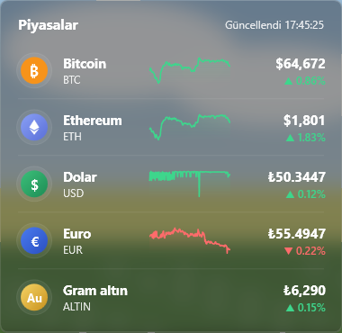
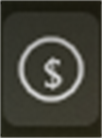
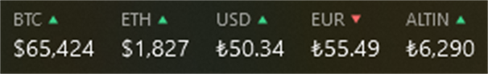

# Taskbar Money Tracker

Windows 11 görev çubuğuna gömülü, minimal bir fiyat göstergesi. Bitcoin, Ethereum, dolar, euro ve gram altını görev çubuğundan canlı takip etmenizi sağlar.

İki görünümü vardır; sağ tık menüsündeki **Görünüm** seçeneğiyle aralarında geçilir:

- **İkon + panel (varsayılan):** görev çubuğunda tek bir para ikonu durur. Tıklayınca üstünde bir panel açılır; her kalem için ad, 24 saatlik mini grafik, fiyat ve günlük değişim yüzdesi görünür.
- **Yatay şerit:** tüm kalemler görev çubuğunda yan yana durur; üstte etiket ve yön oku (yeşil ▲ / kırmızı ▼), altta fiyat.

<p align="center">
  
</p>
<p align="center">
  <br>
  <sub>İkon + panel görünümü: ikona tıklayınca yukarıdaki panel açılır.</sub>
</p>

<p align="center">
  <br>
  <sub>Yatay şerit görünümü.</sub>
</p>

Arka plan saydamdır; yazı rengi görev çubuğunun açık ya da koyu temasına göre kendiliğinden ayarlanır.

## İndirme

Derlemeden kullanmak için [son sürümden](https://github.com/erdoganersinkeskin/claude-taskbar-money-tracker/releases/latest) `TaskbarTickerNative.exe` dosyasını indirin. Tek dosyadır (~1,5 MB), kurulum ve .NET gerektirmez. Adımlar için [Tek exe ile çalıştırma](#tek-exe-ile-çalıştırma) bölümüne bakın.

## Gereksinimler

Aşağıdakiler yalnızca kaynak koddan derlemek ya da WPF sürümünü çalıştırmak içindir.


- Windows 11 (Windows 10'da denenmedi)
- Derlemek için [.NET 10 SDK](https://dotnet.microsoft.com/download) veya üzeri
- Çalıştırmak için .NET 10 Desktop Runtime

Harici paket (NuGet) bağımlılığı yoktur. Arayüz WPF ile yazılmıştır; panel ve menü, .NET'in kendi içindeki Windows 11 Fluent temasını kullanır ve Windows'un açık/koyu uygulama temasını izler.

## Derleme ve çalıştırma

```bash
dotnet publish TaskbarTicker/TaskbarTicker.csproj -c Release -o TaskbarTicker/publish
```

```bash
TaskbarTicker/publish/TaskbarTicker.exe
```

Uygulama görev çubuğunda başka bir gömülü araç (ör. sistem monitörü) bulursa onun hemen sağına, bulamazsa en sola yerleşir.

## Yerel sürüm (.NET gerektirmez)

[TaskbarTickerNative](TaskbarTickerNative) klasöründe aynı uygulamanın, .NET kurulu olmayan bilgisayarlarda da çalışan ikinci bir sürümü bulunur. Görünümü, davranışı ve `config.json` biçimi aynıdır; fark içeridedir:

| | WPF sürümü (`TaskbarTicker`) | Yerel sürüm (`TaskbarTickerNative`) |
| --- | --- | --- |
| Çalıştırmak için | .NET 10 Desktop Runtime | Hiçbir şey (tek exe) |
| Exe boyutu | ~0,2 MB + .NET | ~1,5 MB |
| Bellek (özel) | ~160 MB | ~10 MB |
| Arayüz | WPF + Fluent teması | Doğrudan Win32 + GDI+ |
| Ağ / JSON | HttpClient / System.Text.Json | WinHTTP / kendi küçük JSON okuyucusu |
| Sağ tık menüsü | Fluent görünümlü | Windows'un standart menüsü |

Yerel sürüm C# ile yazılıp Native AOT ile makine koduna derlenir. Derlemek için .NET 10 SDK'ya ek olarak Visual Studio'nun **C++ ile masaüstü geliştirme** bileşeni gerekir:

```bash
dotnet publish TaskbarTickerNative/TaskbarTickerNative.csproj -c Release -r win-x64 -o TaskbarTickerNative/publish
```

```bash
TaskbarTickerNative/publish/TaskbarTickerNative.exe
```

Derleme `'vswhere.exe' is not recognized` hatasıyla bağlama adımında durursa, `C:\Program Files (x86)\Microsoft Visual Studio\Installer` klasörünü `PATH`'e ekleyip yeniden deneyin.

### Tek exe ile çalıştırma

Uygulamanın tamamı tek bir dosyadır: `TaskbarTickerNative.exe`; yanında DLL ya da kurulum gerekmez. Dosyayı [son sürümden](https://github.com/erdoganersinkeskin/claude-taskbar-money-tracker/releases/latest) indirebilir ya da kendiniz derleyebilirsiniz (derleme sonunda `TaskbarTickerNative/publish` klasöründe oluşur). Kullanmak için:

1. `TaskbarTickerNative.exe` dosyasını hedef bilgisayara indirin ya da kopyalayın (USB, ağ paylaşımı vb.). Hedefte .NET ya da Visual Studio gerekmez; 64 bit Windows 11 yeterlidir.
2. Dosyayı kalıcı ve yazılabilir bir klasöre koyun, örneğin `C:\Users\<kullanıcı>\Apps\TaskbarTicker`. Ayarlar exe'nin yanına yazıldığı için `Program Files` gibi yönetici izni isteyen klasörleri kullanmayın.
3. Exe'ye çift tıklayın. Pencere açılmaz; birkaç saniye içinde görev çubuğunda para ikonu belirir.
4. İlk çalıştırmada exe'nin yanında varsayılan ayarlarla `config.json` oluşur. Kendi ayarlarınızı taşımak isterseniz mevcut `config.json` dosyanızı exe'nin yanına kopyalayın.
5. Açılışta kendiliğinden başlaması için ikona sağ tıklayıp **Windows ile başlat**'ı işaretleyin. Bu kayıt exe'nin o anki yolunu tutar; dosyayı sonradan taşırsanız seçeneği kapatıp yeniden açın.

Bilinmesi gerekenler:

- Exe dijital olarak imzalı değildir. İnternetten ya da e-postayla indirildiyse Windows SmartScreen "Windows kişisel bilgisayarınızı korudu" uyarısı gösterebilir; **Ek bilgi → Yine de çalıştır** ile açılır.
- Kapatmak için ikona sağ tıklayıp **Çıkış**'ı seçin. Kaldırmak için "Windows ile başlat"ı kapatın, uygulamadan çıkın ve klasörü silin; başka bir yere dosya ya da kayıt bırakmaz.
- Bir hata olursa exe'nin yanında `error.log` dosyası oluşur.

İki sürüm aynı anda çalışabilir (ayrı pencere, ayrı "Windows ile başlat" kaydı, her biri kendi exe'sinin yanındaki `config.json`). Yazılar iki farklı çizim motoruyla çizildiği için harf kenarlarında çok küçük farklar olabilir.

Tanılama için yerel sürüm, çizimlerini ekrana dokunmadan dosyaya yazabilir:

```bash
TaskbarTickerNative/publish/TaskbarTickerNative.exe --dump cikti-klasoru
```

## Kullanım

| İşlem | Nasıl |
| --- | --- |
| Paneli açma / kapama | İkona (ya da şeride) sol tıklayın; panel `Esc` ile ya da başka bir yere tıklayınca da kapanır |
| Görünüm değiştirme | Sağ tık → **Görünüm** → **İkon + panel** / **Yatay şerit** |
| Taşıma | Sol tuşla tutup yatayda sürükleyin; konum kaydedilir |
| Elle yenileme | Sağ tık → **Şimdi yenile** |
| Ayarları düzenleme | Sağ tık → **Ayarları aç (config.json)**, kaydedince **Ayarları yeniden yükle** |
| Otomatik başlatma | Sağ tık → **Windows ile başlat** |
| Kapatma | Sağ tık → **Çıkış** |

"Windows ile başlat" o anki exe yolunu kaydeder; exe'yi başka bir klasöre taşırsanız seçeneği kapatıp yeniden açın.

## Güncelleme sıklığı

| Durum | Varsayılan | Ayar |
| --- | --- | --- |
| Panel açıkken | 15 saniye | `panelOpenRefreshSeconds` |
| İkon görünümü, panel kapalıyken | 300 saniye | `panelClosedRefreshSeconds` |
| Yatay şerit görünümü | 60 saniye | `stripRefreshSeconds` |

Panel açıldığında veri `panelOpenRefreshSeconds` değerinden eskiyse hemen tazelenir. Hepsinin alt sınırı 5 saniyedir.

## Ayarlar

Ayarlar, exe'nin yanındaki `config.json` dosyasında tutulur. Dosya yoksa ilk çalıştırmada varsayılanlarla oluşturulur:

```json
{
  "view": "panel",
  "panelOpenRefreshSeconds": 15,
  "panelClosedRefreshSeconds": 300,
  "stripRefreshSeconds": 60,
  "stripShowPercent": false,
  "panelTintPercent": 45,
  "offsetX": null,
  "items": [
    { "label": "BTC", "name": "Bitcoin", "symbol": "BTC-USD", "prefix": "$", "panelDecimals": 0, "stripDecimals": 0 },
    { "label": "ETH", "name": "Ethereum", "symbol": "ETH-USD", "prefix": "$", "panelDecimals": 0, "stripDecimals": 0 },
    { "label": "USD", "name": "Dolar", "symbol": "USDTRY=X", "prefix": "₺", "panelDecimals": 4, "stripDecimals": 2 },
    { "label": "EUR", "name": "Euro", "symbol": "EURTRY=X", "prefix": "₺", "panelDecimals": 4, "stripDecimals": 2 },
    { "label": "ALTIN", "name": "Gram altın", "symbol": "GC=F", "multiplyBy": "USDTRY=X", "divideBy": 31.1035, "prefix": "₺", "panelDecimals": 0, "stripDecimals": 0 }
  ]
}
```

| Alan | Açıklama |
| --- | --- |
| `view` | Görünüm: `panel` (ikon + panel) ya da `strip` (yatay şerit) |
| `stripShowPercent` | `true` ise şeritte okun yanında günlük değişim yüzdesi de yazılır |
| `panelTintPercent` | Panelin buzlu cam zemini üstündeki tonun yoğunluğu: `0` tamamen cam, `100` düz zemin (varsayılan `45`) |
| `offsetX` | Görev çubuğunun solundan piksel cinsinden konum; `null` ise otomatik |
| `items[].label` | Görünen kısa etiket |
| `items[].name` | Panelde etiketin altında görünen açıklama |
| `items[].symbol` | Yahoo Finance sembolü (ör. `BTC-USD`, `USDTRY=X`, `GC=F`) |
| `items[].prefix` | Fiyatın önüne yazılan simge |
| `items[].panelDecimals` | Panelde ondalık basamak sayısı |
| `items[].stripDecimals` | Yatay şeritte ondalık basamak sayısı |
| `items[].multiplyBy` | İsteğe bağlı: fiyat bu sembolün fiyatıyla çarpılır |
| `items[].divideBy` | İsteğe bağlı: sonuç bu sayıya bölünür |

### Örnekler

Bitcoin'i TL olarak göstermek:

```json
{ "label": "BTC", "name": "Bitcoin", "symbol": "BTC-USD", "multiplyBy": "USDTRY=X", "prefix": "₺", "panelDecimals": 0, "stripDecimals": 0 }
```

Ons altını dolar olarak göstermek:

```json
{ "label": "ONS", "name": "Ons altın", "symbol": "GC=F", "prefix": "$", "panelDecimals": 0, "stripDecimals": 0 }
```

## Veri kaynağı ve sınırlar

- Fiyatlar Yahoo Finance'in herkese açık grafik servisinden alınır; API anahtarı gerekmez. Servis resmî bir API değildir, ileride değişebilir ya da erişimi kısıtlanabilir.
- Gram altın, vadeli ons altın (`GC=F`) × USD/TRY ÷ 31,1035 ile hesaplanır. Kapalıçarşı serbest piyasa fiyatından farklı çıkabilir.
- Döviz ve altın piyasaları hafta sonu kapalıdır; bu kalemler hafta içi güncellenir. Kripto paralar 7/24 güncellenir.
- Veri alınamazsa son bilinen değer soluk renkte gösterilir.
- Yalnızca ana ekrandaki görev çubuğunda görünür.

## Nasıl çalışır

Uygulama, görev çubuğu penceresinin (`Shell_TrayWnd`) alt penceresi olarak saydam, katmanlı bir Win32 penceresi oluşturur. İkon ve şerit WPF ile ekran dışı bir bitmap'e çizilir ve bu pencereye basılır. Bu sayede görev çubuğu gizlendiğinde (tam ekran uygulamalar) gösterge de gizlenir. Explorer yeniden başlarsa gösterge kendini birkaç saniye içinde yeniden gömer. Panel ise ikonun üstünde açılan ayrı, her zaman üstte duran bir WPF penceresidir.

| Dosya | İçerik |
| --- | --- |
| [App.xaml](TaskbarTicker/App.xaml) | Uygulama tanımı; Fluent teması burada açılır (`ThemeMode="System"`) |
| [TickerController.cs](TaskbarTicker/TickerController.cs) | Akış: zamanlayıcı, yenileme aralıkları, görünüm seçimi, sağ tık menüsü |
| [TaskbarHost.cs](TaskbarTicker/TaskbarHost.cs) | Görev çubuğuna gömülen pencere, sürükleme ve tıklama olayları |
| [TaskbarRenderer.cs](TaskbarTicker/TaskbarRenderer.cs) | İkonun ve yatay şeridin çizimi |
| [PanelWindow.xaml](TaskbarTicker/PanelWindow.xaml) | Panelin arayüzü |
| [Sparkline.cs](TaskbarTicker/Sparkline.cs) | Paneldeki mini grafik |
| [CoinIcons.cs](TaskbarTicker/CoinIcons.cs) | Paneldeki renkli yuvarlak kalem ikonları (logo dosyası kullanılmaz, kodla çizilir) |
| [ScreenCapture.cs](TaskbarTicker/ScreenCapture.cs) | Panelin buzlu cam zemini için arkasındaki ekran bölgesini yakalar |
| [QuoteService.cs](TaskbarTicker/QuoteService.cs) | Fiyatların çekilmesi ve türetilmiş kalemlerin hesaplanması |
| [Config.cs](TaskbarTicker/Config.cs) | Ayar modeli, `config.json` okuma/yazma |
| [Native.cs](TaskbarTicker/Native.cs) | Win32 çağrıları |

## Lisans

[MIT](LICENSE)
